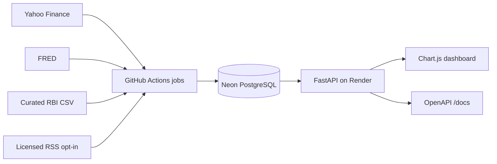

# FinPipeline

FinPipeline is an India-first end-of-day market and macro data system built with FastAPI, PostgreSQL, Alembic, GitHub Actions, and a vanilla Chart.js dashboard.

**Live:** [dashboard](https://finpipeline.onrender.com) · [API docs](https://finpipeline.onrender.com/docs) · [health](https://finpipeline.onrender.com/health)

## Architecture



The web process is deliberately not the scheduler. Render may sleep; GitHub Actions still runs idempotent jobs against Neon. APScheduler remains available only through `ENABLE_APSCHEDULER=true` for local use.

## What is tracked

- 16 India-context instruments: Nifty 50, Sensex, Bank Nifty, India VIX, ten NSE large caps, USD/INR, and Brent crude.
- Four global comparison equities: AAPL, GOOGL, MSFT, and TSLA.
- Five original US FRED series and seven verified India FRED series.
- A manually curated RBI repo-rate CSV whose rows include an official source URL and as-of date.
- Raw OHLC, adjusted close, exchange-local market date, rolling averages, annualized volatility, 2σ move days, and run telemetry.
- An experimental ten-feature India/US historical-analogy engine using expanding no-lookahead z-scores.

Live counts, observation dates, and stale flags come from `/methodology`, `/freshness`, and `/metrics`; this README does not freeze mutable production row counts.

## Local run

```bash
docker compose up --build
```

Open <http://localhost:8000>. Load data explicitly:

```bash
docker compose run --rm api python -m src.jobs run market --market india --backfill
docker compose run --rm api python -m src.jobs run market --market global --backfill
docker compose run --rm api python -m src.jobs run macro --backfill
docker compose run --rm api python -m src.jobs run regime
```

Or use Python 3.11+, Poetry, and your own PostgreSQL:

```bash
poetry install --no-root
poetry run alembic -c finpipeline/alembic.ini upgrade head
PYTHONPATH=finpipeline poetry run uvicorn src.api:app --reload --port 8000
```

Copy `.env.example` and set:

| Variable | Purpose |
|---|---|
| `DATABASE_URL` | Pooled runtime/short-job PostgreSQL URL; keep Neon TLS parameters |
| `MIGRATION_DATABASE_URL` | Direct PostgreSQL URL for Alembic, backup, and restore |
| `SECRET_KEY` | Random JWT signing secret |
| `AUTH_USERNAME`, `AUTH_PASSWORD` | Optional legacy protected endpoint login |
| `FRED_API_KEY` | Optional; public CSV is the fallback |
| `ENABLE_APSCHEDULER` | Defaults false; production schedules are external |
| `NEWS_FEEDS_ENABLED` | Comma-separated feed IDs, only after suitable permission |

## API surface

Public endpoints include `/health`, `/metrics`, `/freshness`, `/methodology`, `/instruments`, `/stocks/summary`, rolling-average and volatility routes, `/macro/{indicator}`, `/news`, `/moves`, `/regime/current`, and `/pipeline/runs`. Raw price history and the legacy analysis/backtest routes remain protected. See `/docs` for parameters and response schemas.

The regime response is historical similarity on a small, revised-data sample—not a forecast or investment advice. Its 1/3/6-month outcomes mean 21/63/126 later Nifty trading sessions.

## Deploy free with Neon + Render + GitHub Actions

1. Create a Neon project. Save its pooled URL as `DATABASE_URL` and direct URL as `MIGRATION_DATABASE_URL`, preserving the supplied TLS parameters.
2. Back up the old database with `MIGRATION_DATABASE_URL="$OLD_URL" ./scripts/backup_db.sh current.dump`.
3. Restore with `MIGRATION_DATABASE_URL="$NEON_DIRECT_URL" ./scripts/restore_db.sh current.dump`, then run Alembic to head.
4. In Render, apply `render.yaml`; set both URLs and `ENABLE_APSCHEDULER=false`. Verify `/health`, `/freshness`, and live database counts before retiring the old database.
5. Add `DATABASE_URL`, `MIGRATION_DATABASE_URL`, and optional `FRED_API_KEY` as GitHub Actions secrets. Run each workflow manually once, then inspect `/pipeline/runs`.
6. Add a low-frequency uptime check if you want fewer visible Render cold starts. It is not required for ingestion.
7. GitHub may disable public-repository schedules after 60 days without repository activity. Set an external reminder before day 60 and re-enable/manual-dispatch workflows if needed.

Detailed database migration notes are in [`docs/HOSTING.md`](docs/HOSTING.md).

## News licensing

Economic Times, Mint, and Business Standard feeds were technically live when checked, but were not enabled because their terms restrict the planned automated reuse/evaluation without permission. Moneycontrol returned HTTP 403. No publisher corpus or invented evaluation result is committed. See [`docs/news_tagging_eval.md`](docs/news_tagging_eval.md).

## Tests

```bash
poetry run pytest -q
```

CI also migrates a real PostgreSQL 16 service, runs the database idempotency test, builds the image, and validates Compose.

## Limitations

- Yahoo and FRED can be delayed or revise observations.
- FRED observation dates do not provide true real-time-vintage macro backtests.
- Missing exchange holidays are absent sessions, not generated values.
- The RBI repo-rate file needs manual review after policy changes.
- Free Render instances cold-start, and free-service terms can change.
- This is a research and engineering project, not investment advice.
